# CosmicGuide — UI Architecture & Necessary Features

> Principle: one tab = one job. Reveal depth progressively, never dump everything on one screen.

---

## Must-Have vs Skip — Decision Table

| Feature | Keep? | Why |
|---|---|---|
| Daily horoscope | ✅ Must | Core daily habit |
| Moon + Rising sign | ✅ Must | Credibility — Sun-only feels toy-like |
| Basic natal chart wheel | ✅ Must | The #1 thing users come for |
| Today's planetary transits | ✅ Must | Makes chart feel *alive* daily |
| Push notification (daily) | ✅ Must | Only reliable retention tool |
| Tarot draw | ✅ Must | High engagement, visually fun |
| Fortune generator | ✅ Must | Quick dopamine, shareable |
| Compatibility checker | ✅ Must | Social — people always check their partner |
| Kundli matcher | ✅ Must | Core for Indian audience |
| Stories feed | ✅ Must | Keeps app feeling fresh without opening features |
| Reading history | ✅ Must | Basic expected by users after 3rd session |
| Real streak tracking | ✅ Must | Habit loop — currently hardcoded |
| Shareable chart card | ✅ Must | Biggest free growth lever |
| Weekly horoscope | ✅ Must | Low effort, high expected |
| Moon phase indicator | ✅ Must | One widget, high perceived value |
| — | — | — |
| Synastry chart wheel | ⏳ Later | Complex — add after natal chart works |
| Friends / social feed | ⏳ Later | Needs auth + backend social graph first |
| Live astrologer chat | ⏳ Later | Operations-heavy, not MVP |
| Retrograde calendar | ⏳ Later | Content feature — add to stories |
| Year-ahead report | ⏳ Later | Premium PDF — Phase 4 |
| Home screen widget | ⏳ Later | Nice, but native Android/iOS work needed |
| Oracle free-text Q&A | ⏳ Later | Add to fortune screen as "Ask More" |
| Void-of-course moon alerts | ❌ Skip | Too niche for mass audience |
| Multiple house systems | ❌ Skip | Power-user only, adds UI complexity |

---

## Navigation Structure

**5 bottom tabs — one job each:**

| Tab | Icon | Job |
|---|---|---|
| Home | 🌟 | Daily snapshot — what's happening today |
| Chart | ☿ | Your birth chart + transits — who you are |
| Discover | 🔮 | Tarot, Fortune, Stories — explore |
| Match | 💫 | Compatibility + Kundli — relationships |
| Profile | 👤 | Your data, history, settings |

> **Current problem:** Horoscope is its own tab but is really part of Chart. Fortune and Kundli are pushed from Home but have no permanent home. This means users can't easily find them again.

---

## UI Structure Diagram

```mermaid
graph TD
    App([CosmicGuide]) --> Nav[Bottom Navigation — 5 Tabs]

    Nav --> T1[🌟 Home]
    Nav --> T2[☿ Chart]
    Nav --> T3[🔮 Discover]
    Nav --> T4[💫 Match]
    Nav --> T5[👤 Profile]

    %% HOME
    T1 --> H1[Greeting + Date]
    T1 --> H2[Daily Horoscope Card — tap to expand]
    T1 --> H3[Lucky: Number · Color · Mood]
    T1 --> H4[Moon Phase Widget — tap for detail]
    T1 --> H5[Quick Actions: Tarot · Fortune]
    T1 --> H6[Stories Feed — top 3]
    H2 -->|tap| HD[Horoscope Detail Sheet\nGeneral · Love · Career · Health tabs]
    H4 -->|tap| MD[Moon Phase Detail Sheet\nPhase · ritual suggestion]

    %% CHART
    T2 --> C1[Chart Wheel — Sun · Moon · Rising · planets]
    T2 --> C2[Your Big 3 — Sun ☉ Moon ☽ Rising ↑]
    T2 --> C3[Today's Transits — 3 key influences]
    T2 --> C4[Weekly Forecast]
    C1 -->|tap planet| PD[Planet Detail Sheet\nMeaning + house position]
    C3 -->|tap transit| TD[Transit Detail Sheet\nWhat it means for you today]

    %% DISCOVER
    T3 --> D1[Tarot Draw]
    T3 --> D2[Fortune Generator]
    T3 --> D3[Stories — full list with category filter]
    D1 -->|after reveal| SC[Share Card Sheet]
    D2 -->|after generate| SC

    %% MATCH
    T4 --> M1[Compatibility Checker]
    T4 --> M2[Kundli Matcher]
    M1 -->|result| MR[Match Result Screen\nScore · Description · Love Advice · Strengths · Challenges]
    M2 -->|result| KR[Kundli Result Screen\nAshta Koota · Dosha · Analysis]

    %% PROFILE
    T5 --> P1[Avatar · Name · Sun ☉ Moon ☽ Rising ↑]
    T5 --> P2[Stats: Streak · Readings · Fortunes — real data]
    T5 --> P3[Reading History — tarot · fortune · horoscope]
    T5 --> P4[Personality Traits Card]
    T5 --> P5[Edit Birth Details]
    T5 --> P6[Settings: Notifications · Theme · Language]
    T5 --> P7[Upgrade to Premium CTA]

    %% Shared
    SC --> SH[Native Share Sheet — image card]

    %% Styling
    style App fill:#1A1A2E,color:#FFD700,stroke:#FFD700
    style Nav fill:#16213E,color:#fff,stroke:#7C4DFF
    style T1 fill:#1E2A4A,color:#FFD700,stroke:#FFD700
    style T2 fill:#1E2A4A,color:#7C4DFF,stroke:#7C4DFF
    style T3 fill:#1E2A4A,color:#00BFA5,stroke:#00BFA5
    style T4 fill:#1E2A4A,color:#E91E63,stroke:#E91E63
    style T5 fill:#1E2A4A,color:#fff,stroke:#ffffff
```



---

## Screen-by-Screen: What to Show vs Hide

### 🌟 Home
**Always visible:** greeting, horoscope card (3-line preview), lucky chips, moon phase mini-widget, 3 story cards  
**On tap:** horoscope expands to full-screen sheet  
**Remove from home:** quick-action grid for Fortune/Tarot → move to Discover tab (reduce cognitive load)

---

### ☿ Chart *(new tab replacing current Horoscope tab)*
**Always visible:** chart wheel, Big 3 (Sun/Moon/Rising badges), today's top 3 transits  
**On tap:** any planet → planet detail sheet; any transit → what it means today  
**Weekly button:** switches wheel to weekly forecast mode  
**Keep simple:** no house systems dropdown, no aspect lines toggle in MVP — just the clean wheel

---

### 🔮 Discover *(merges current Tarot + Fortune + Stories)*
**Layout:** two large cards at top (Tarot · Fortune), stories feed below  
**Tarot:** draw button → flip animation → interpretation → share button  
**Fortune:** topic + mood → generate → result → share button  
**Stories:** category chips (All · Weekly · Planetary · Relationships · Rituals) + vertical list  
**Why merge:** Fortune and Tarot are low-frequency features. Making them top-level tabs wastes navigation real estate.

---

### 💫 Match *(current Match + Kundli)*
**Layout:** two segmented options at top — "Western" (Compatibility) · "Vedic" (Kundli)  
**No deep nesting** — result appears on same screen below the form  
**History row:** last 3 matches shown under the form as quick-repeat chips

---

### 👤 Profile
**Remove:** hardcoded stats (24 readings, 7-day streak)  
**Add:** real reading history list, edit birth details button  
**Keep:** personality traits card, sign details, premium CTA  
**Settings as a sub-screen** (not a modal) — notifications, theme toggle, account

---

## What to Remove from Current UI

| Remove | Currently | Better Alternative |
|---|---|---|
| Horoscope as separate bottom tab | Tab 2 | Merge into Chart tab |
| Fortune card in home quick actions | Home | Discover tab — not urgent enough for home |
| Kundli pushed from home only | Home quick action | Match tab — permanent home |
| Hardcoded stats (readings: 24, streak: 7) | Profile | Real data from DB |
| "Pull to refresh" missing | Home | Add — users expect it |

---

## Progressive Disclosure Principle

```
Layer 1 — Always visible (home screen glance)
  → Daily horoscope preview, moon phase, lucky info

Layer 2 — One tap (expand / sheet)
  → Full horoscope detail, planet meanings, transit explanations

Layer 3 — Intentional navigation (dedicated screen)
  → Chart wheel, Tarot session, Fortune session, Match session

Layer 4 — Premium / deep (locked or scrolled down)
  → Weekly forecast, Year report, Reading history, Synastry
```

Never put Layer 3/4 content in Layer 1 view.
